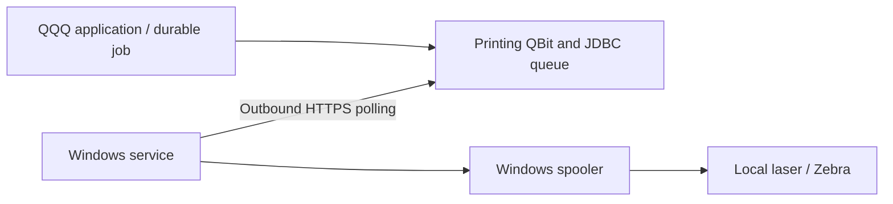

# QQQ Printing

Cloud printing for QQQ 4.1+, paired with the [Windows AppKit connector](https://github.com/QRun-IO/qqq-print-agent) and the [shared protocol](https://github.com/QRun-IO/qqq-print-protocol). The Windows connector initiates outbound HTTPS polling; the cloud needs no inbound route into the facility.

**0.1.0-rc.1 is an initial prerelease**, tested against QQQ **4.1.0-RC.20** and Java 21. The optional native UI demo uses QQQ frontend **1.0.0-RC.37**. GitHub releases provide a library JAR, POM and SHA-256 checksums. This repository does not claim Maven Central publication or provide a standalone executable/fat JAR.

Implemented: single-use enrollment, device credentials, inventory/approval, PDF/ZPL submission, durable JDBC queue, idempotency, claim/content/events, native QQQ setup/test-print processes, read-only device/printer/job tables and a durable enqueue effect target.



See the [screen walkthrough](docs/UI-WALKTHROUGH.md), [operations and troubleshooting](docs/OPERATIONS.md), [contributing](CONTRIBUTING.md), [security reporting](SECURITY.md), [changelog](CHANGELOG.md), and [Apache-2.0 license](LICENSE).

## Build and verify

Install Java 21. Clone this repository and `qqq-print-protocol` as siblings. CI pins protocol commit `f977bd01b62ceb7539190fd2861809537fcf504c`; use that commit for reproducible compatibility tests. Use the checked-in wrapper (Maven 3.9.11).

```powershell
.\mvnw.cmd verify
.\mvnw.cmd dependency:build-classpath '-Dmdep.outputFile=target/runtime-classpath.txt' '-Dmdep.includeScope=runtime'
```

On Linux/macOS use `bash ./mvnw verify` and the corresponding wrapper commands. First builds download dependencies; `-o` is only appropriate after they are cached.

Checkstyle runs during validate. Tests exercise real H2 persistence, native QQQ metadata/processes and real loopback HTTP through Javalin, including the shared fixtures and withdrawal of a locally exposed printer. Keep `../qqq-print-protocol` checked out or pass `-Dprinting.protocol.fixtures=<fixture-directory>`.

## Local server

Set `QQQ_PRINT_ADMIN_TOKEN` to a random value of at least 24 characters in the process environment; never put it in source or command arguments. Then:

```powershell
.\mvnw.cmd exec:java
```

The demo binds `127.0.0.1:18081`, persists H2 at `.local/printing`, and exposes `/printing/v1`. Optional `QQQ_PRINT_PORT` and `QQQ_PRINT_JDBC_URL` override those defaults. It does not log the administrative token. Local HTTP is for development; terminate TLS for remote connectors.

For a directly managed Java process, classpath is `target/classes;` followed by `target/runtime-classpath.txt`, and main class is `com.kingsrook.qbits.printing.PrintingDemo`.

## Native QQQ UI preview

A separate local demo serves the real QQQ frontend with synthetic device/printer/job records. It binds only to `127.0.0.1:18082`, uses mock authentication and registers no device transport routes, so its synthetic jobs cannot be claimed by a physical connector.

```powershell
.\mvnw.cmd -Pui-demo package dependency:build-classpath '-Dmdep.outputFile=target/ui-classpath.txt' '-Dmdep.includeScope=runtime'
$uiClasspath = 'target/classes;' + (Get-Content target/ui-classpath.txt -Raw).Trim()
java -cp $uiClasspath com.kingsrook.qbits.printing.PrintingUiDemo
```

Open `http://127.0.0.1:18082`. On Linux/macOS use `:` as the classpath separator. Set JVM property `-Dprinting.ui.port=<port>` before the main class to choose another port. This preview is distinct from the credential-protected protocol demo on port 18081; neither replaces deployment-specific authentication and authorization.

## Add to a QQQ application

For a source checkout, `mvnw.cmd install` (or `bash ./mvnw install`) installs the verified library into your local Maven repository. For a GitHub release, download the JAR, matching POM and `SHA256SUMS`, verify the checksums, then install those artifacts locally or through your organization's artifact repository. Example using the release files in the current directory:

```powershell
.\mvnw.cmd install:install-file '-Dfile=qbit-printing-0.1.0-rc.1.jar' '-DpomFile=qbit-printing-0.1.0-rc.1.pom'
```

After the artifact is available in your configured repository, add:

```xml
<dependency>
   <groupId>com.kingsrook.qbits</groupId>
   <artifactId>qbit-printing</artifactId>
   <version>0.1.0-rc.1</version>
</dependency>
```

Supply an existing JDBC DataSource/pool and a QQQ RDBMS backend pointing to that same database. Initial schema is created by `initialize()`; the implementation uses portable H2/PostgreSQL SQL, but only H2 has been tested so far.

```java
PrintingService printing = new PrintingService(dataSource, tenantId);
printing.initialize();
new PrintingQBitProducer().withConfig(new PrintingQBitConfig()
   .withBackendName("appRdbms")
   .withService(printing)).produce(qInstance, "printing");
server.addRouteProvider(new PrintingRoutes(printing, context -> hostPrintingAdminGuard(context)));
```

`hostPrintingAdminGuard` is the host's own authenticated administrator policy, not a supplied library method. The service is bound to one tenant; use a separate host service instance for each tenant. Device token verification and job ownership are enforced on every device operation. Management service methods are intended for trusted application code; enforce user/facility authorization before calling them.

For native QQQ screens, grant `printing_admin` and populate the session's `printing_tenant` security key with the tenant ID. The Printing home shows device health, queue status and work needing attention, with Devices, Printers and Print jobs beneath it. It nests under an existing `admin` app when available. Processes are dashboard/table/record actions, not navigation entries. Secret/token and document columns are excluded from metadata. Table mutations are rejected; use the service/processes instead.

Typical setup: run **Enroll a print device** from Printing home or Print devices, enroll the Windows connector, and select local queues to expose in its companion/tray. Use **Set printer approval** to choose a named device and one of its printers. Test-print forms offer only exposed, approved printers supporting the chosen format. Device and printer choices respect the current user's tenant access.

On Printers, select one or more rows or open a printer record to **Approve printers**, **Disable printers**, **Print a test page**, or **Print a test label**. Standard QQQ review/result screens show the selected scope; preview does not print. Each selected printer is read again under the current user's permissions before execution. Jobs display the related printer and device names; approval, availability, format and status fields have named choices.

Metadata names follow QBit conventions: tables and data sources use `printing_*`, while processes/widgets use `printing...`. The initial namespace is fixed to `printing`. The QBit preserves the host's `QBrandingMetaData`; customer identity belongs in the host branding, not a custom QBit build.

Two independent settings govern dispatch: `available` means the queue is present in the latest locally selected inventory; `enabled` means a QQQ administrator approved it. New submissions and claims require both. Removing a queue from local selection makes it unavailable without deleting its approval/history. An empty inventory withdraws all queues. Withdrawing a queue cannot retract a job already accepted by Windows.

Application code calls `printing.submit(JSONObject)` with the shared `SubmitJobRequest` fields. A stable business idempotency key returns the same job when retried; changing document/options/target under the same key fails. PDF is sent as bytes encoded once in base64; ZPL is UTF-8 printer-ready bytes. Default limit is 20 MiB. Queue approval and format compatibility are checked before insertion.

```java
JSONObject job = printing.submit(new JSONObject()
   .put("deviceId", deviceId)
   .put("printerId", printerId)
   .put("title", "Packing slip")
   .put("format", "PDF")
   .put("contentBase64", Base64.getEncoder().encodeToString(pdfBytes))
   .put("idempotencyKey", "shipment:" + shipmentId + ":packing-slip:v1")
   .put("options", new JSONObject().put("copies", 1).put("scale", "ACTUAL_SIZE")));
String printJobId = job.getString("jobId");
```

The returned ID identifies durable queue acceptance. Check job status asynchronously. The [protocol v1 specification](https://github.com/QRun-IO/qqq-print-protocol/blob/f977bd01b62ceb7539190fd2861809537fcf504c/README.md) defines HTTP endpoints, JSON fields, integrity checks and lifecycle semantics.

For durable QQQ jobs register `PrintEnqueueEffectTarget` as an `IDEMPOTENT_EXTERNAL` target in `DurableJobsMetaData`, then emit the submit-request payload. The target replaces the payload idempotency key with the durable effect key. Its SENT result means accepted into the queue, not physical output. This implementation uses its own JDBC transaction; do not register it as LOCAL_TX. Authorize the destination in the emitting process before writing the effect. QQQ's durable dispatcher runs with a `QSystemUserSession` and does not propagate the user's tenant keys. For that trusted outbox path only, the target resolves the service configured on the dispatcher's current QQQ instance; that service fixes the tenant and rejects devices belonging to another tenant. The payload cannot choose a service or tenant. A cached target resolves the current instance on every call. Inline user calls retain the `printing_tenant` scope check, and native management processes (including enrollment) still require both administrator permission and matching tenant scope. Do not expose direct effect emission through an arbitrary user-supplied target/payload endpoint.

## Deliberate first-version limits

The implemented path targets an explicit device/printer. Logical destination bindings, cancellation, reprint workflow, automatic reconciliation, clustered throughput optimization, retention and alerts are follow-ups. Documents are durably stored as base64 in the database for this first path; object-storage integration is deferred. Custom paper dimensions are rejected; configure the Windows queue. Received/submitting jobs are not automatically offered again. The queue records SPOOLED honestly and does not assert physical delivery.

The protocol demo and synthetic native UI preview are separate local hosts. Attaching the QBit to a deployed application and its real authentication/facility policy remains a host integration task. PostgreSQL behavior, production deployment, upgrades, cancellation/reprint and broad printer-driver coverage are not certified by the initial H2/laser tests.

## Verified initial path

On 2026-10-29, both the development Windows connector and the installed LocalSystem service printed a PDF to a local laser printer. The user confirmed both physical pages. MSI installation/start and temporary uninstall passed. Zebra hardware testing is deferred until a Zebra is connected. A SPOOLED status alone is never used as proof of physical output.

## CI and releases

Pull requests and `main` pushes run Java 21/Maven wrapper verification with the immutable sibling protocol checkout. A tag matching the POM version runs the same gates, then publishes the tested JAR, POM and `SHA256SUMS` as GitHub release assets. Hyphenated versions create prereleases. The workflow does not publish to Maven Central, deploy a QQQ application or print to hardware. GitHub CI results must be checked after publication; local test success is not a claim that remote CI has run.

## Printing home

The admin-only Printing home uses stock QQQ widgets: a purpose/scope/help header, actionable exceptions, four health tiles, and a full-width pending/recent work list. Counts and record links use QQQ queries under the viewer's tenant. Device disconnection means no heartbeat for 90 seconds; job failure tiles cover jobs created in the past 24 hours. Older failures remain in Print jobs. An empty installation explains enrollment and printer setup.

This RC implements the happy path of the [QQQ dashboard standard](https://github.com/QRun-IO/qqq/blob/main/docs/DASHBOARD-STANDARD.md), with explicit remaining gaps: RC.20 carries role/priority hints in widget default values; attention uses scoped database queries and 60-second refresh rather than the core live attention feed; dismiss/snooze, interactive URL-backed page scope, and stale/retry presentation depend on further core/frontend integration. It has not passed the standard's full responsive/accessibility audit. No custom frontend or HTML dashboard is used.
