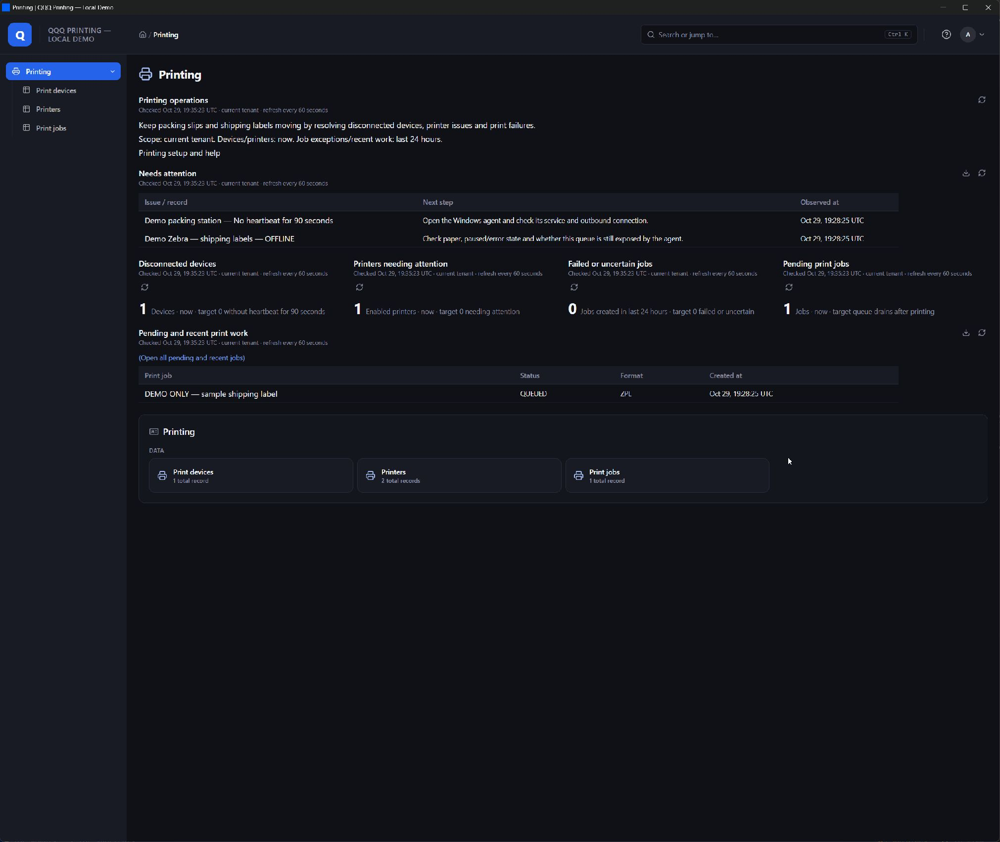
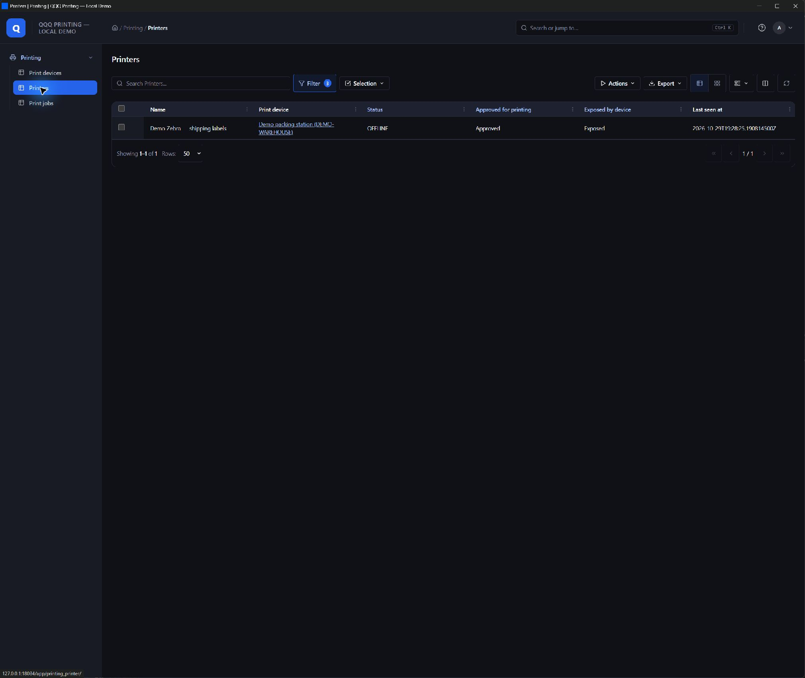
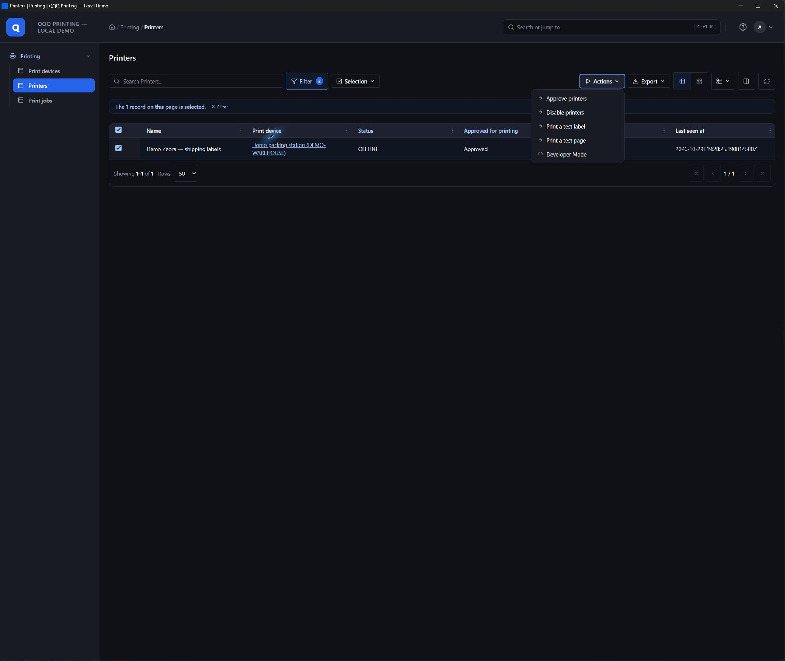
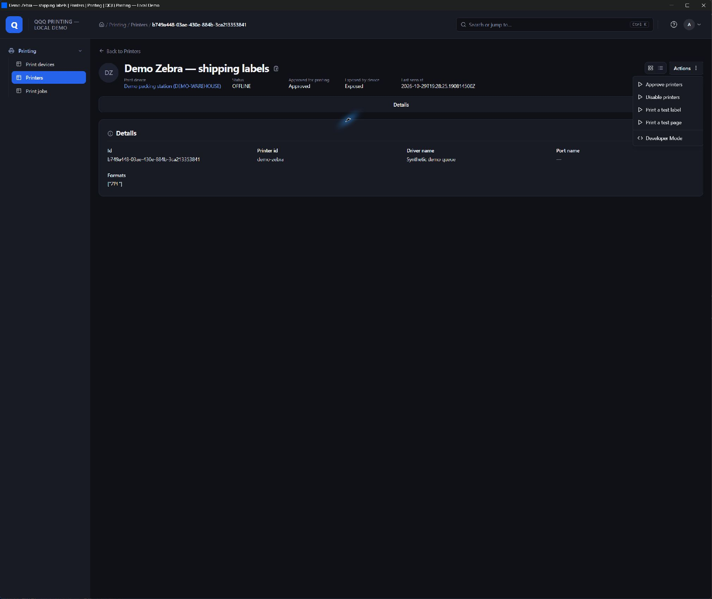
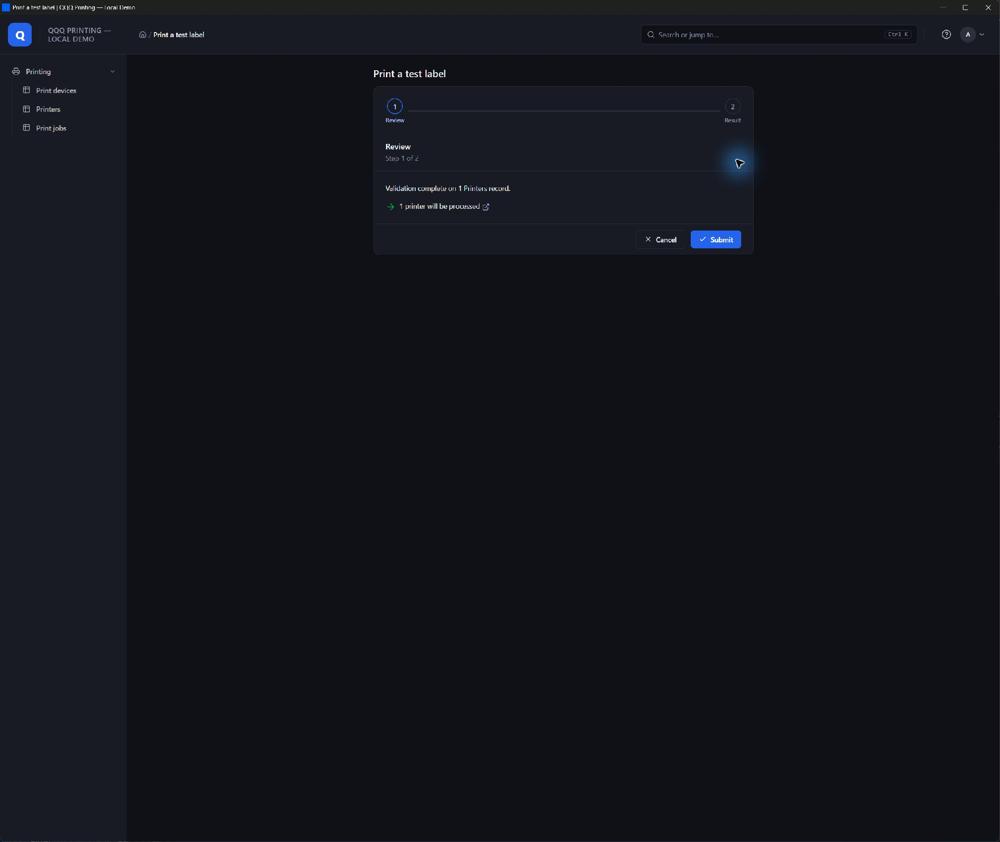
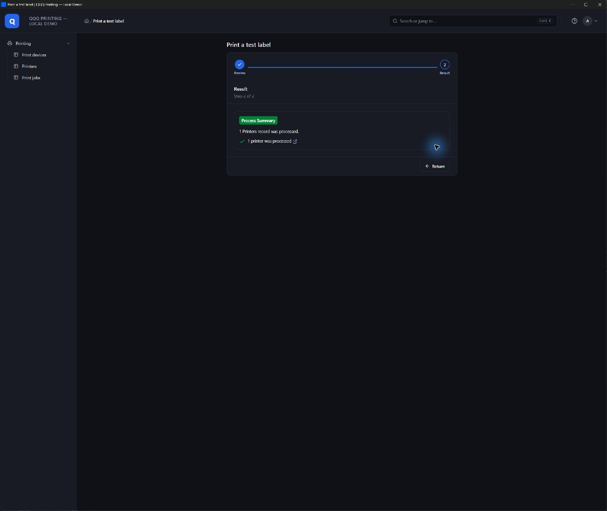

# Printing screens and operator workflow

The local preview runs the actual QQQ frontend with synthetic records. It has no device transport routes and cannot send its jobs to a real printer. Follow the README to start it; the default address is `http://127.0.0.1:18082`.

## Printing home

Open **Printing** in the navigation. The home presents the current tenant and refresh scope, actionable exceptions, device/printer/job health counts, and pending/recent work. Follow an exception or count to its filtered table, then open the affected record. Disconnected devices use a 90-second heartbeat threshold; recent failures cover the last 24 hours. Older failures remain available in Print jobs.

## Enroll a facility computer

Choose **Enroll a print device** from Printing home or the Print devices table. Use the resulting short-lived enrollment code in the Windows companion's Connection settings. Once enrolled, select the installed printer queues to expose in the companion. Exposure is opt-in and persists in the service.

Open **Printers** in QQQ. The operational columns show the printer name, named print device, status, approval, local exposure, and last contact. Approval and exposure are independent: a printer must be both approved in QQQ and exposed on the computer before new jobs can be dispatched.

## Act on one printer or a selection

Select one or more printer rows and open **Actions**, or open an individual printer record and use its actions. Available operations include **Approve printers**, **Disable printers**, **Print a test page**, and **Print a test label**. The standard QQQ review screen describes the selection; reviewing does not print. Submitting a test action queues one job per selected eligible printer.

Use a PDF test page for the laser queue and a ZPL test label for the Zebra queue. Standalone setup/test processes use named device and printer choices, with printer choices filtered by device and supported format. Operators do not need to type database identifiers.

## Follow a job

Open **Print jobs** to see the related printer/device, title, format, and lifecycle state. Open the record for diagnostic details. `QUEUED` means waiting for the connector; `SPOOLED` means accepted by Windows, not confirmed physical output. `FAILED` and `OUTCOME_UNKNOWN` require investigation; an uncertain submission is not automatically reprinted.

The Windows companion shows recent jobs and a persistent status footer. **View service logs** opens the service snapshot; the separately labeled companion activity log covers desktop-app diagnostics. Closing the companion hides it to the tray while the service continues.

## Preview acceptance and limits

The live preview was inspected with frontend 1.0.0-RC.37: the six operational printer columns, named device relationship, disabled generic write actions, and dashboard-to-filtered-table navigation were observed. Selecting the synthetic Zebra, opening Print a test label, reviewing and submitting completed with one printer processed. No physical printer was connected to this demo. Native process authorization and multi-printer execution are also covered by Java tests. A broad browser/accessibility run and final elevated companion interaction run remain separate acceptance tasks; see the README and the Windows repository's UX review.
